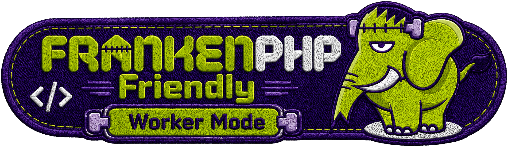
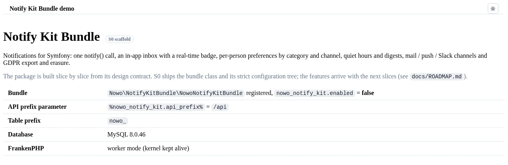

# Notify Kit Bundle

[](https://github.com/nowo-tech/NotifyKitBundle/actions/workflows/ci.yml) [](https://packagist.org/packages/nowo-tech/notify-kit-bundle) [](LICENSE) [](https://php.net) [](https://symfony.com) [](#tests-and-coverage)

> ⭐ **Found this useful?** Install it from [Packagist](https://packagist.org/packages/nowo-tech/notify-kit-bundle) and give it a star on [GitHub](https://github.com/nowo-tech/NotifyKitBundle): it helps us maintain and improve the project.

**Notifications for Symfony: one notify() call, an in-app inbox with a real-time badge, per-person preferences by category and channel, quiet hours and digests, mail / push / Slack channels and GDPR export and erasure.**

> 🚧 **Status: 0.1.0 (S1 core inbox).** The package is built slice by slice from its design contract
> ([docs/CONTRACT.md](docs/CONTRACT.md), 221-B). S1 ships `notify()` with the in-app rows (coalescing, dedupe, deny
> by default), the type registry, retention and the schema check; the bell, preferences and channels land with the
> slices in [docs/ROADMAP.md](docs/ROADMAP.md).

> 📋 **Compatible with Symfony 7.4, 8.0 and 8.1** · PHP 8.2+ (Symfony 8.x requires PHP 8.4+)



This bundle is built for **FrankenPHP worker mode with the kernel kept alive and not reset between requests**: no
request state in services (the one per-transaction buffer is cleared by the bundle at every boundary), a worker test
(one kernel, 2,000 requests of two users) in CI.

**Standard Symfony by default, DDD / hexagonal opt-in:** zero configuration in a standard project; public ports are
interfaces and value objects, bundle-owned tables are mapped in XML and referenced by id, the bundle never flushes your
EntityManager.

## Features

Available in S1: the entry point, the in-app rows (coalescing, dedupe, write-time access), the type registry,
retention, the schema check, transaction-safe writes (503-ready transient failures). Planned (see the roadmap): the rest.

- **One entry point**, `NotifierInterface::notify()`: type, recipients (by id), actor, context, target, local URL,
  params, urgency, *involved* people; validated, written after your commit, fanned out per recipient and channel.
- **In-app inbox**: one row per recipient (never the actor, only when the recipient may open the target), coalescing of
  repeats, read / unread / mark all, unread count, visibility re-checked at read time, retention.
- **Header bell and inbox page** on UiKit + FormKit, with a real-time badge (Mercure private updates, or a bounded poll).
- **Preferences matrix** per person × category × channel (only deviations stored), *all* / *involved* scope, master
  switch, per-context switches and overrides; the bell row is always written by default (Q-O2).
- **Quiet hours and digests** for mail, push and Slack (time zone, weekdays, urgent bypass; hourly / daily digests).
- **Channels**: built-in `in_app`; bridges for mail (Symfony Mailer + MailKit branding), push (PwaBundle) and Slack
  (SlackKit); your own channels through `ChannelInterface`.
- **Personal data**: UserKit eraser and export for every bundle table, actor unlinking.
- **Optional public API** `<prefix>/notifications/v1` (off by default), authenticated by ApiTokenBundle.

## Installation

```bash
composer require nowo-tech/notify-kit-bundle
```

See [docs/INSTALLATION.md](docs/INSTALLATION.md). Nothing is registered while `nowo_notify_kit.enabled` is false.

## Requirements

- PHP >= 8.2, < 8.6
- Symfony 7.4, 8.0 or 8.1

## Configuration

```yaml
# config/packages/nowo_notify_kit.yaml
nowo_notify_kit:
    enabled: false
```

Every key of the contract is already accepted (strict tree): [docs/CONFIGURATION.md](docs/CONFIGURATION.md).

## Demo

`demo/symfony8`: Symfony 8.1, FrankenPHP worker mode, MySQL, on http://localhost:8222 (`make -C demo up`), built on UiKit; `make -C demo/symfony8 test-e2e` runs the Playwright check.



## Documentation

- [Installation](docs/INSTALLATION.md)
- [Configuration](docs/CONFIGURATION.md)
- [Usage](docs/USAGE.md) (incl. using it from a DDD / hexagonal application)
- [Roadmap](docs/ROADMAP.md) (slices and open questions)
- [Contract](docs/CONTRACT.md)
- [Security](docs/SECURITY.md)
- [FrankenPHP worker audit](docs/FRANKENPHP-WORKER-AUDIT.md)
- [Demo with FrankenPHP](docs/DEMO-FRANKENPHP.md)
- [Upgrading](docs/UPGRADING.md) · [Changelog](docs/CHANGELOG.md) · [Release](docs/RELEASE.md)
- [Architecture](docs/ARCHITECTURE.md) · [PSR](docs/PSR.md) · [Spec-driven development](docs/SPEC-DRIVEN-DEVELOPMENT.md) · [Spec Kit](docs/SPEC-KIT.md)
- [Contributing](docs/CONTRIBUTING.md) · [GitHub CI](docs/GITHUB_CI.md) · [Engram](docs/ENGRAM.md)
- [Code of Conduct](CODE_OF_CONDUCT.md)

## Tests and coverage

```bash
make test               # PHPUnit in Docker
make test-coverage-100  # fails below 100 % of src/
make release-check      # every gate, demo included
```

- PHP: 100 % of `src/` (gate in CI).

## License

MIT. See [LICENSE](LICENSE).

## Author

Created by [Héctor Franco Aceituno](https://github.com/HecFranco) at [Nowo.tech](https://nowo.tech).
